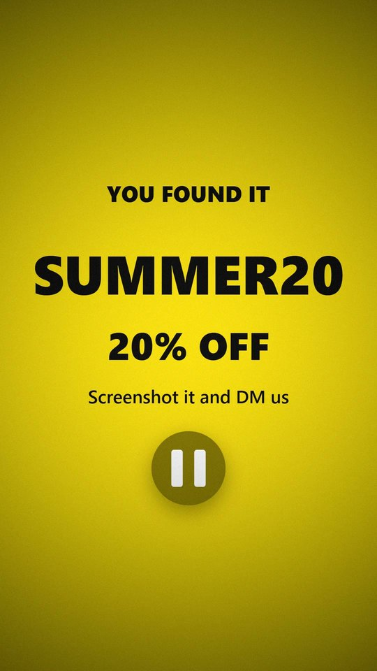

# Pause Challenge

Makes "pause at the right moment" videos for brands. Product photos flash by and a discount code shows for only
1, 2 or 4 frames; viewers who pause in time get the code.

**Live:** https://pausetowin.vercel.app

## How it works

- `film.js` is a pure function from frame number to picture.
- Exporting draws every frame and encodes it with WebCodecs `VideoEncoder` and mp4-muxer into a 1080×1920, 30 fps
  MP4, all in the browser. It never records in real time, because one dropped frame would lose the code.
- `tools/test.js` exports in headless Chrome, reads the MP4 back with ffmpeg, and checks the code sits on exactly
  the planned frames.

## Stack

Plain HTML, CSS and JavaScript, canvas, WebCodecs. mp4-muxer (MIT) is vendored in `vendor/`.
